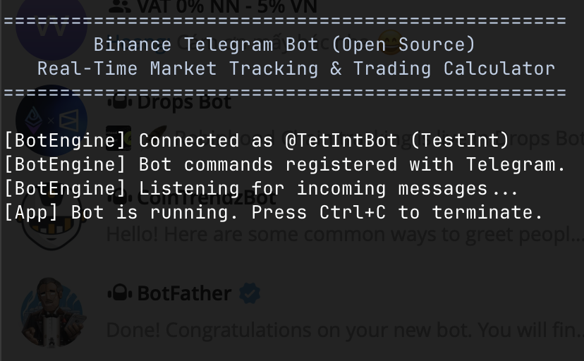

# Binance Telegram Bot (Open Source)

A fast, lightweight, and stateless Telegram Bot for real-time Binance market tracking and crypto calculations, written in modern C# (.NET 10).

<p align="center">
  
</p>

## 🚀 Key Features

- **100% Open Source & Zero Database Dependency**: Entirely stateless with in-memory thread-safe caching. No MySQL, SQLite, Redis, or external databases required.
- **Pure Binance Integration**: Directly utilizes Binance REST API via `Binance.Net` for real-time Spot and Futures (USDT-M) public market data. No API keys required for public market queries.
- **No Chart Commands**: Pure text/monospace tables for maximum performance, minimal memory footprint, and seamless operation on low-spec VPS or containers.
- **Strict Slash Commands**: Only responds to explicit commands starting with `/` (e.g. `/p btc`), preventing unwanted responses to normal chat conversations in groups.
- **Aligned Telegram Formatting**: Uses monospace HTML pre-formatted code blocks for clean, mobile-friendly alignment across all devices.

---

## 📋 Commands & Usage

| Command | Description | Example |
| :--- | :--- | :--- |
| `/p <symbols...>` | Spot prices with 24h change & trend | `/p btc eth sol bnb` |
| `/pp <symbol>` | Detailed 24h market stats (High, Low, Vol, Trades) | `/pp btc` |
| `/pa <coin>` | All Binance spot trading pairs for a coin | `/pa btc` |
| `/pf <symbols...>` | Binance Futures (USDT-M) prices | `/pf btc eth` |
| `/ppf <symbol>` | Detailed 24h Futures stats | `/ppf btc` |
| `/tpp [count] [minVol]` | Top 24h gainers / pump (Spot USDT) | `/tpp 10` or `/tpp 10 50` |
| `/tdd [count] [minVol]` | Top 24h losers / dump (Spot USDT) | `/tdd 10` or `/tdd 10 50` |
| `/tvv [count]` | Top 24h volume coins (Spot USDT) | `/tvv 10` |
| `/buy <coin> <price> [usd]` | Calculate buy ROI and target profit | `/buy btc 60000 1000` |
| `/sell <coin> <price> [usd]`| Compare sold price vs current market price | `/sell btc 65000 1000` |
| `/val <qty> <coin> [target]`| Calculate crypto portfolio value in USDT & BTC/ETH | `/val 0.5 btc 100000` |
| `/calc <expr>` | Math calculator with K/M/B suffixes | `/calc 10k * 1.5 - 200` |
| `/ping` | Check bot connectivity, uptime, and status | `/ping` |
| `/help` | Display command guide and syntax | `/help` |

---

## 🛠️ Quick Start

### 1. Prerequisites
- [.NET 10.0 SDK](https://dotnet.microsoft.com/download) (or Docker)
- A Telegram Bot Token from [@BotFather](https://t.me/BotFather)

### 2. Configuration

Copy `appsettings.example.json` to `appsettings.json`:

```bash
cp appsettings.example.json appsettings.json
```

Edit `appsettings.json` and insert your Telegram Bot Token:

```json
{
  "Telegram": {
    "BotToken": "123456789:ABCdefGhIJKlmNoPQRsTUVwxyZ"
  },
  "Binance": {
    "ApiKey": "",
    "ApiSecret": "",
    "CacheSeconds": 2,
    "DefaultQuoteAsset": "USDT"
  }
}
```

> **Note:** You can also pass the token via an environment variable without modifying `appsettings.json`:
> ```bash
> export TELEGRAM_BOT_TOKEN="123456789:ABCdefGhIJKlmNoPQRsTUVwxyZ"
> ```
> Or via command-line argument:
> ```bash
> dotnet run -- --token "123456789:ABCdefGhIJKlmNoPQRsTUVwxyZ"
> ```

### 3. Build & Run

```bash
# Restore and build
dotnet build

# Run
dotnet run
```

---

## 🐳 Docker Support

Run with Docker:

```bash
# Build Docker image
docker build -t binance-telegram-bot .

# Run container
docker run -d \
  --name binance-bot \
  --restart unless-stopped \
  -e TELEGRAM_BOT_TOKEN="your_bot_token_here" \
  binance-telegram-bot
```

---

## 📄 License

This project is licensed under the [MIT License](LICENSE).
